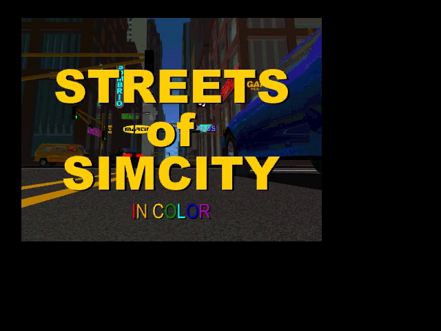
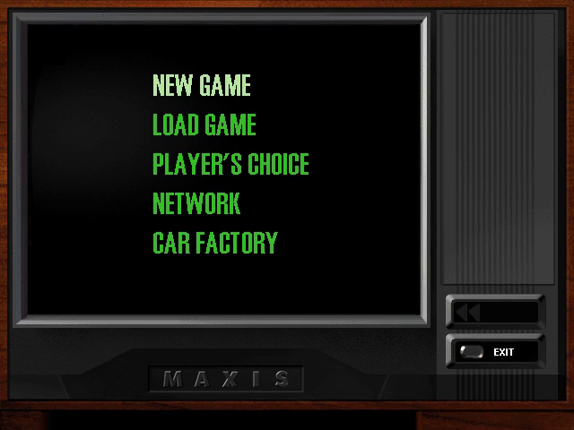
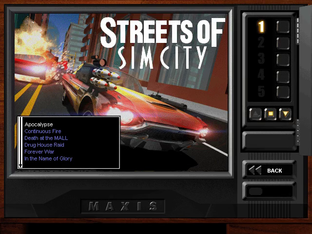
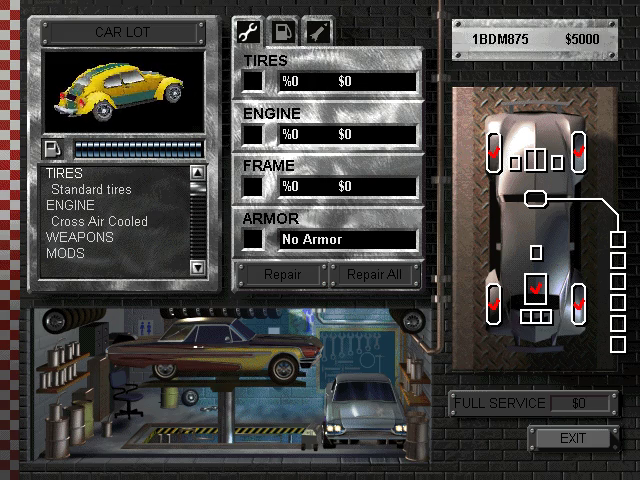
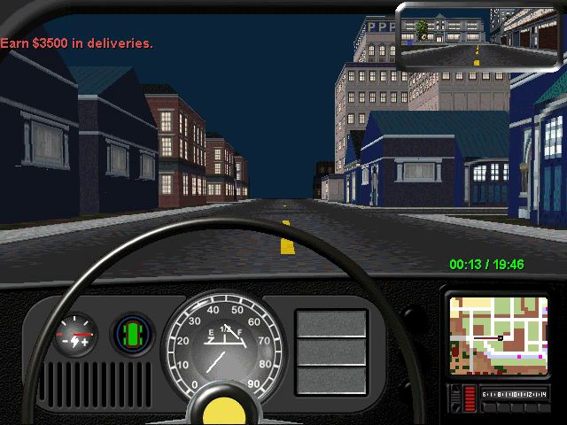
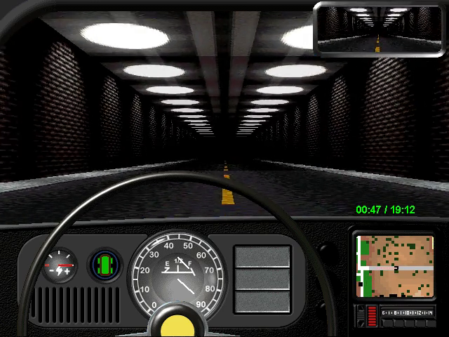
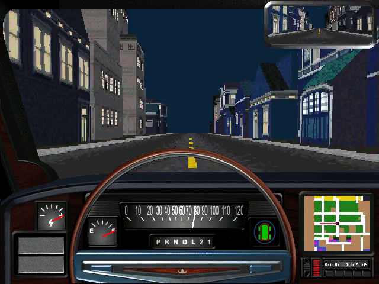
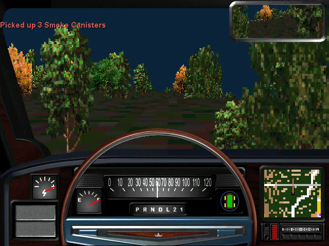

# Streets of SimCity — Static Recompilation

Static recompilation of **Streets of SimCity** (Maxis, 1997) from its shipping
Win32 binary, `Streets.exe`, to native C, on the
[pcrecomp](https://github.com/sp00nznet/pcrecomp) toolchain. The game's own
code, recompiled, running on a current Windows: no compatibility mode, no
8-bit desktop, no CD in the drive.

Part of the pcrecomp collection and its shared house style (layout, CLI,
`--headless --record`, conformance harness); siblings on the same host are
[mtm](https://github.com/sp00nznet/mtm) and
[tiberiansun-recomp](https://github.com/sp00nznet/tiberiansun-recomp).

## Status: alpha — it drives

`Streets.exe` is lifted whole and runs on pcrecomp's `native32` host. It plays
the intro video, goes through the main menu, the career's name dialog and
mission list and the garage, and drives the first mission's city on the
software renderer: down the street, through a tunnel and into a wall, frame
for frame as the shipping code does with the same input. A whole mission has
not been played yet, sound has not been checked, and one of the game's
guarded divides is not handled the way the original handles it
([bringup.md](docs/bringup.md) 6).

| Stage | State |
|---|---|
| The build | the US CD's `Streets.exe`, 1997-10-22, no protection ([architecture.md](docs/architecture.md)) |
| Function catalog (`tools/catalog.py`, pcrecomp `disasm32`) | 22,304 functions, 97.2% of `.text` |
| Lift (`run_lift.py`) | 22,308 functions, 6.6M lines of C, **0 lift errors** |
| Boot: CRT, window, the CD check, DirectDraw | done |
| Intro video (Smacker) | done |
| Main menu, name dialog, career mission list | done |
| Garage: the car in 3D, software renderer | done, same as the original code |
| The city: driving (software renderer) | drives, same as the original code with the same script |
| Player's Choice: SimCity 2000 cities | drives them, from the CD and saved by the SimCity 2000 recomp |
| A whole mission | not played yet |
| Sound (DirectSound), radio | not checked |
| Network, OpenGL and Glide renderers | not started |
| Conformance (`tools/conformance.py`) | **12/12** milestones, from the CD check to driving; lift 0 errors, 0 unresolvable ITAIL labels |
| Compilers | clang-cl on netlab; MSVC (x86), Visual Studio 2022 |

The walls so far, each with how it was found, are in
[docs/bringup.md](docs/bringup.md): the CD check, a clipper, Smacker drawing
into its own DC, the system palette, the primary in screen coordinates; then
in the hand-written rasterizer `loopne`, a 3dfx query to nowhere, routines
that return to their caller's caller, and unrolled loops entered through
tables; and a divide the game expects to fault.

## Screenshots

From headless recordings (`--headless --record`), the recompiled game:

| Intro | Main menu |
|---|---|
|  |  |
| **Career: missions** | **Garage (3D, software renderer)** |
|  |  |
| **The city** | **Through a tunnel** |
|  |  |
| **A SimCity 2000 city: NYC, saved by the SimCity 2000 recomp** | **Rio, from the SimCity 2000 CD** |
|  |  |

## Getting Started

You need **your own Streets of SimCity CD**, or an ISO of it. Nothing from the
game is in this repository and nothing is downloaded for you. The lifted C is
generated on your machine from your copy and is never distributed.

This needs two pcrecomp changes that are not on its `main` yet: Joliet ISOs
(`feat/iso-peek-joliet`, pcrecomp#92) and `loopne` (`fix/lift32-loopcc-zf`, pcrecomp#93). Until they
land, use a pcrecomp checkout with both merged.

### Quick start

1. Download this repository (the green **Code** button, then **Download ZIP**)
   and unzip it somewhere with 3 GB free.
2. Double-click **`Setup.cmd`**.

It checks for Python 3.10+, the `pefile` and `capstone` packages, the pcrecomp
toolkit (beside this folder, as `pcrecomp`), Visual Studio 2022 with the C++ x86
tools, CMake and Ninja, and **asks** before installing anything. It finds the
CD in a drive, or an ISO in this folder or your Downloads, or asks for one;
copies the game into `game\`, catalogs, lifts and builds. A rerun skips
finished steps. If it stops, it says why in one sentence; the details are in
`setup.log`.

It ends with `Streets of SimCity (recomp).cmd` in this folder: double-click it
to play.

### Step by step

Prerequisites: Windows 10/11, **Python 3.10+** (`py -3 --version`), **git**,
**Visual Studio 2022** (any edition, or the Build Tools) with *Desktop
development with C++* including the x86 tools, **CMake 3.20+** and **Ninja**,
`ffmpeg` on PATH for `--record`, and the pcrecomp toolkit cloned **beside**
this repository:

```
some-folder\
  pcrecomp\           <- git clone https://github.com/sp00nznet/pcrecomp
  streetsofsimcity\   <- this repository
```

1. Python packages:
   ```
   py -3 -m pip install --user pefile capstone
   ```
2. Copy the game off your CD, or an ISO of it, into `game\`:
   ```
   py -3 tools\gamefiles.py StreetsOfSimCity.iso
   ```
   Expected: `978 files in ...\game`.
3. The function catalog (about 6 minutes):
   ```
   py -3 tools\catalog.py
   ```
   Expected, among its output: `[catalog] 1127 addresses from code-pointer
   tables in .data` and `Functions: 22304`.
4. Lift (about 2 minutes):
   ```
   py -3 run_lift.py
   ```
   Expected: `lifted 22308   errors 0`.
5. Build (from a plain terminal; `build.cmd` sets up the x86 compiler itself;
   15 to 45 minutes the first time):
   ```
   build.cmd
   ```
6. Play:
   ```
   build\ssc.exe --run
   ```

The usual trip-ups: `python` opening the Microsoft Store (that is Windows'
alias; use `py -3`), and a PATH change that needs a new terminal window.

## Usage

```
ssc [--run] [--headless] [--record out.mp4] [--frames N] [--shot N:file.bmp]
    [--diff A,B] [--key NAME@MS[+HOLD]] [--click X,Y@MS] [--scale N]
    [--game game] [--open FILE] [--watchdog S] [--native-trace] [--callbacks]
    [--ddraw-trace] [--original [--lifted VA,...]]
```

Without `--run` it only maps and binds the image (a dry run). `--headless`
draws nothing on screen and takes no focus; `--record` pipes the screen to
ffmpeg at 30 fps. `--key` and `--click` script input in milliseconds from the
start (`--key ESC@6000` skips the intro). `--original` runs the shipping
machine code under the same host, for comparison, and `--lifted VA,...` runs
just those functions lifted inside it, to bisect a lift bug. `--watchdog S` stops the
run after S seconds and says where it was.

Played windowed, the Video menu picks the scaling filter and window size,
and F11 or Alt+Enter is fullscreen.

Player's Choice drives any SimCity 2000 city, from the SimCity 2000 CD or
saved by [its recomp](https://github.com/sp00nznet/simcity2000); both kinds
are checked ([bringup.md](docs/bringup.md) 7). Played windowed, it asks for
the `.sc2` file; `--open FILE` answers that dialog unseen, for headless runs:

```
build\ssc.exe --run --headless --record nyc.mp4 --open ..\simcity2000\game\CITIES\NYC.SC2 ^
    --key ESC@6000 --click 255,183@14000 --click 368,392@22000 ^
    --click 568,437@30000 --key UP@47000+30000
```

The game folder is mapped to a free drive letter for the run and offered to
the game as its CD; the letter is removed when the game exits.

## Building from source

`build.cmd` builds locally with MSVC. Day to day the build runs on the
[netlab](https://github.com/sp00nznet/netlab) farm with
`netlab build streetsofsimcity`, and `netlab check streetsofsimcity` builds and runs the conformance
harness.

`py -3 tools\conformance.py` runs a scripted headless session and scores it:
milestones from the CD check to driving in the city, and lift health. It fails on
a regression against `conformance.json`, and prints SKIP without `game\`.

[docs/architecture.md](docs/architecture.md) has the pipeline and what the
host changes about the game's world; [docs/bringup.md](docs/bringup.md) has
each wall and how it was found.

## What is not in this repo

The game, its data and anything derived from its binary: the function
catalog, the lifted C (`src/recomp/gen/`), the seeds and run logs are
generated locally into gitignored folders and never committed.

## License

The code and documentation here are MIT ([LICENSE](LICENSE)). The grant
stops at our own work: it does not reach the game, which is
Streets of SimCity © 1997 Maxis, or anything lifted from it, which is a
derivative of the game's binary and is never committed here.
